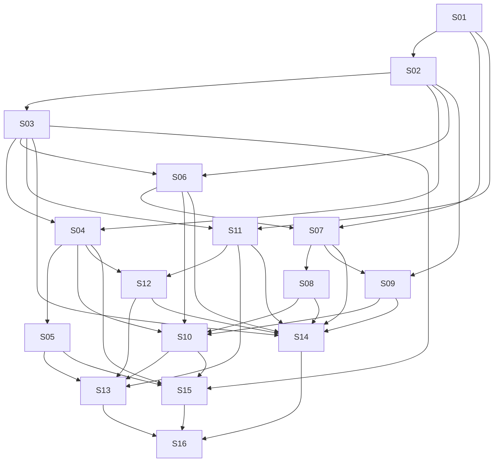

# Epic: Bootstrap the Music Gatherings App

Status: S01–S12 implemented on `main`. S13–S16 remain plans.

## 1. Purpose and scope

Build a full-stack app that helps musicians and their audience find, organize,
and prepare songs for informal jam sessions. Users suggest tracks, attach useful
metadata, vote, and access lyrics, chord charts, tablature, and sheet music in
representations suited to their needs. Agents can inspect and analyze authorized
application data.

The stack is Python/FastAPI, a modular React/TypeScript frontend, SQLite structured
storage, and filesystem object storage initially. Ingestion and normalization are
private HTTP microservices. Docker Compose provides the initial deployment.

Working defaults (not previously confirmed product decisions):

- One default jam crew initially; retain crew-scoped ownership for future growth.
- Username/password accounts and admin-approved access requests.
- Prioritize lyrics and chord charts, with upload/linking of PDF sheet music.
  Automated notation extraction and full tablature transformations are capability-
  dependent, not promised in the first release.
- A single host and one replica of each ingestion service initially.
- No calendar, attendance, rehearsal scheduling, payments, or complex crew workflow.

## 2. User experience: mobile first

The default authenticated route is the **jam track view**: the crew's shared list
of suggested tracks. Also provide **jam crew**, **track search**, **track detail**,
and **administration/testing** views.

- Design for narrow touch screens first, progressively enhancing to tablet/desktop.
- Track list: requester, optional title/artist, genres, piano suitability, vote
  state/totals, artifact availability, and clear loading/empty/error states.
- Track detail: metadata, versions, provenance, warnings, and links/views for
  lyrics, chord charts, tabs, and sheet music.
- Search: clearly distinguish local results from online discovery; explicit import.
- Crew: members and access requests, without over-engineered jam management.
- Audience view emphasizes lyrics; musician views expose appropriate artifacts,
  key, tuning, capo, and available transposition controls.
- Target WCAG 2.2 AA: semantic controls, visible focus, keyboard operation,
  accessible labels/status announcements, contrast, and reduced-motion support.
- Touch targets should normally be at least 44 CSS px; avoid hover-only actions.
- Core navigation/forms must not overflow horizontally at 320 CSS px. Music/tab
  panels may deliberately scroll within their own labeled region; do not break
  notation alignment to fit a screen.
- Preserve lyrics/chord alignment with appropriate typography and structured
  rendering, not arbitrary text wrapping. Provide accessible document alternatives
  where available. External-only or unsupported documents need honest fallbacks.
- Use a feature-oriented React/TypeScript structure, reusable design primitives,
  routing, generated API types, and a consistent server-state/query layer.
- Offline/PWA support is not a first-release requirement.

## 3. Architecture and boundaries

```text
React UI / scoped agent clients
             |
       FastAPI application -------- SQLite + FTS5
             |                     filesystem object store
       durable job worker
             |
       private HTTP service network
             +-- Genius ingestion
             +-- Ultimate Guitar ingestion
             +-- future provider adapters
             +-- normalization / post-processing
```

Keep authentication, crews, tracks, votes, local search, orchestration, and artifact
authorization in a modular main application. Do not split those domains into
microservices. External adapters and processing are independently deployable APIs.

Suggested layout (create as implementation slices require it):

```text
backend/                 # FastAPI, domain modules, repositories, migrations
frontend/                # React/TypeScript, feature modules, UI primitives
services/ingestion/      # shared contracts and provider implementations
services/processor/      # canonical documents, transforms, renderers
contracts/               # versioned service contracts and generated schemas
tests/e2e/               # Playwright flows and deterministic fixtures
deploy/                  # Dockerfiles and Compose support
```

Do not require distributed transactions. Main-app durable jobs coordinate services
and recover safely from interrupted or partially successful work.

## 4. Structured data model

Use SQLAlchemy, Alembic, foreign keys, SQLite WAL, busy timeouts, short transactions,
and explicit unique constraints. Keep a practical migration path to PostgreSQL.

| Entity | Responsibility |
| --- | --- |
| User | ID, username, password hash, account status, admin flag |
| Crew / CrewMembership | Shared ownership and membership roles |
| AccessRequest | Pending/approved/rejected requests, minimal retained personal data |
| Track | Song identity; optional title, artist, description, creator |
| TrackVersion | Musical arrangement/transcription/performance; optional key, language, tuning, capo, notes |
| Genre / TrackGenre | Multiple genre labels per track |
| CrewTrack | Track in the crew list; requester, notes, piano suitability |
| TrackVote | One value (-1 or +1) per user and crew track; clearing a vote is supported |
| SourceRecord | Provider/external ID, URL, attribution, retrieval time, storage/usage permissions |
| Artifact | Lyrics, chord chart, tablature, sheet music, canonical document, or rendered output |
| ArtifactDerivation | Input artifacts, profile/configuration, processor version, diagnostics |
| ProcessingProfile | Versioned, validated transformation configuration |
| Job | Durable operation, scope, state, progress, attempts, idempotency key, errors |
| AuditEvent | Security/admin changes and agent actions; redact sensitive content |

Title/artist and other descriptive metadata may be absent. Supply display fallbacks
without storing invented metadata. Piano suitability is unknown/suggested/not
suggested. Use validated JSON for extension metadata; keep filterable fields in
explicit columns. Track genre labels are multi-valued.

Musical versions differ from processing revisions: transposing/rendering an
artifact does not automatically create a new musical version. Chords and instrument
tablature are different types and must not be conflated.

Library ownership, deduplication, votes, artifact visibility, and search must enforce
crew boundaries. Users cannot attach another crew's track or artifact by ID.

## 5. Object storage and artifact lifecycle

Introduce an object-store interface; implement a local filesystem store first:

```text
/data/database/app.sqlite3
/data/objects/<opaque-key>
/data/staging/<temporary-key>
```

- Store immutable raw inputs and derived outputs, with hashes, MIME types, sizes,
  provenance, ownership, and rights in structured metadata.
- Use opaque server-generated keys, atomic writes, bounded uploads/downloads, and
  reconciliation/cleanup for interrupted work. Never accept client filesystem paths.
- Serve through authorization-checked endpoints, never public directory mounting.
- Do not globally deduplicate in ways that disclose another crew's private data.
- Preserve raw artifacts; derived outputs record complete transformation lineage.
- Do not execute downloaded content. Sanitize rendered HTML; safely handle or force
  download of potentially active formats and provide secure content headers.
- Define deletion/retention behavior and coherent database/object backup and restore.
- Keep S3-compatible storage as a later implementation, not a required dependency.

## 6. Local and online search

### Local

`GET /api/v1/search/local?q=...&genre=...&piano_suggested=true`

Index title, artist, genre labels, notes, and authorized-to-store extracted lyrics
using SQLite **FTS5** (not FST5). Support ranking, prefixes, pagination, and snippets.
FTS5 alone is not typo-tolerant: add a bounded fuzzy candidate/ranking strategy
(e.g. RapidFuzz and/or trigram candidates) with tests for actual misspellings.
Avoid full-library scans per request. Return tracks, not one duplicate per artifact.
Keep indexing consistent on import/edit/delete and restrict results/snippets by crew.

### Online

`POST /api/v1/search/online` accepts query, providers, and requested artifact types;
returns a durable job reference. Results expose provider references, availability,
attribution, and import capability. Search does not automatically import.

`POST /api/v1/imports` imports a selected provider result into a new or existing
authorized track/version, optionally applying a processing profile. Avoid automatic
merges based solely on fuzzy title/artist similarity.

## 7. Ingestion microservices and provider policy

Each provider exposes versioned contracts:

```text
GET  /health
GET  /v1/capabilities
POST /v1/search
POST /v1/fetch
```

Capabilities describe formats, extraction support, and retrieval/storage limitations.
Results include provider/external IDs, source URL, optional metadata, available
formats, attribution, rights, warnings, and confidence where meaningful. Use
structured errors, correlation IDs, bounded response sizes, and explicit timeouts.

Investigate `lyricsgenius` and the requested `ultimateultimateguitar` integration:
verify exact package identity, maintenance, supported capabilities, credentials,
licenses, upstream terms, and safe sample results before committing to an adapter.
Do not assume these libraries can legally download and redistribute all content.
If storage/redistribution is disallowed or unknown, default to reference/link-only
behavior until explicitly permitted. Never bypass access restrictions.

Provider credentials are private. Use configured upstream hosts, safe redirect
handling, and SSRF protections; do not offer arbitrary URL fetching. Service errors
must not expose credentials or full third-party payloads to ordinary users.

## 8. Configurable rate limiting and resilience

Enforce provider limits inside each ingestion service, covering **every outbound
HTTP attempt**, including pagination, retries, and redirects. Overall and operation
limits apply together. Any shared HTTP client or library wrapper must make these
requests observable and limitable; opaque automatic retries cannot bypass limits.

Illustrative configuration, not authoritative upstream allowances:

```yaml
provider: ultimate_guitar
rate_limits:
  overall:
    requests: 20
    period_seconds: 60
    burst: 2
  search:
    requests: 6
    period_seconds: 60
  fetch:
    requests: 10
    period_seconds: 60
  max_concurrency: 1
  min_request_interval_seconds: 3
```

- Define and test limiter semantics: configured burst and quotas plus minimum
  interval/concurrency restrictions must all be respected. Use a monotonic clock.
- Queue background requests when capacity is unavailable; expose waiting reason,
  next eligible time when known, progress, and cancellation through jobs.
- Respect upstream `429` and `Retry-After` (delta seconds and HTTP dates); apply
  provider-wide cooldown and capped exponential backoff with jitter.
- Bound retries and total job duration. Circuit-break repeated upstream failures;
  distinguish unavailable, throttled, forbidden, and permanent not-found failures.
- Cache permitted search results with TTL and coalesce identical in-flight requests.
  Cache keys include all relevant provider/query options and privacy scope.
- Add main-app per-user online-search/import quotas and bounded queue admission so
  one user cannot monopolize shared provider capacity.
- Admin tests use these same limits; no hidden bypass.
- One replica/provider initially permits an in-process limiter. Document restart
  cooldown behavior and avoid immediately retrying persisted upstream throttling.
  Replication requires a shared limiter; never multiply allowances by replica count.
- Admin visibility: effective limits, utilization, queue depth, cooldown, cache hits,
  and upstream throttles. Validate and audit authorized configuration changes.

## 9. Normalization and post-processing

The private processor exposes:

```text
GET  /health
GET  /v1/capabilities
POST /v1/validate-profile
POST /v1/process
```

Pipeline: parse raw source -> canonical document -> configured transformations ->
rendered outputs + diagnostics. Version schemas, profiles, and processors.

Canonical documents represent sections (verse/chorus/bridge/etc.), lyric lines,
chords anchored to positions, repeat references, tablature blocks, musical metadata,
and references to opaque PDF/image/notation assets. Unsupported scans/PDFs remain
opaque; reliable extraction is not assumed.

Example profile:

```json
{
  "schema_version": 1,
  "steps": [
    {"type": "normalize_sections", "config": {}},
    {"type": "expand_repeated_chords", "config": {
      "strategy": "matching_sections", "on_ambiguity": "warn"
    }},
    {"type": "transpose", "config": {
      "semitones": 2, "accidentals": "prefer_sharps"
    }}
  ],
  "outputs": ["canonical_json", "lyrics_html", "chord_chart_html"]
}
```

Validate configuration against a safe registry of transforms, not arbitrary code.
Keep chords aligned to lyrics through transformations. Chord propagation must warn
or require review on ambiguous structure rather than inventing notation. Chord
transposition does not imply correct tablature or full-score transposition.

User context selects a profile/representation: lyrics-only for audience; chord
charts/tabs and tuning/capo for guitar; available notation/charts for piano. Cache
identical derivations by input hashes, profile, and processor version within safe
ownership boundaries. Do not duplicate objects merely for different users.

## 10. Authentication, authorization, and private services

- Username/password, Argon2id hashes, secure HttpOnly session cookies, CSRF protection,
  session expiry/revocation, and login/access-request throttling.
- Admin approval of account/access requests and a documented first-admin bootstrap
  with no default password. Explicit crew membership checks on all scoped operations.
- Test unauthenticated, nonmember, member, and admin access, including guessed IDs.
- Ingestion/processor services do not need complex authentication. Bind them to a
  private Compose network with no published host ports. The main app is the only
  user-facing API. Revisit internal auth before deployment on an untrusted network.
- Keep secrets out of Git, URLs, logs, provider results, and job diagnostics.
- Apply request/file size limits, parsing time/resource limits, and safe filenames.

## 11. Jobs and service orchestration

Start with SQLite-backed durable jobs and a single worker process; no Redis/Celery
requirement. Support queued/running/succeeded/failed/cancelled states, lease/claim
recovery, progress, bounded retries/timeouts, idempotency, and interruption recovery.

The main worker orchestrates external search, fetch, object persistence, processing,
and index updates. Propagate correlation IDs. Avoid long-running database write
transactions across network or CPU work. Services receive only required payloads,
not the entire application data volume. Define bounded streaming/transfers; introduce
private job-scoped transfer endpoints only if necessary, with narrow authorization.

## 12. API and administration surfaces

```text
/api/v1/auth/*
/api/v1/access-requests
/api/v1/crews/{crew_id}/members
/api/v1/crews/{crew_id}/tracks
/api/v1/crews/{crew_id}/tracks/{id}/vote
/api/v1/tracks/{track_id}
/api/v1/tracks/{track_id}/versions
/api/v1/artifacts/{artifact_id}
/api/v1/artifacts/{artifact_id}/content
/api/v1/search/local
/api/v1/search/online
/api/v1/imports
/api/v1/jobs/{job_id}
/api/v1/admin/providers
/api/v1/admin/processing-profiles
/api/v1/admin/tests/*
```

Define consistent errors, pagination, validation, API versioning, and OpenAPI schemas.
Admin panels cover users/access requests, provider health/configuration, limits,
jobs, processing profiles, and tests. Testing supports search, sample import,
processing previews, diagnostics, and input/output comparison in an isolated test
scope; publishing to the crew library is an explicit action. No arbitrary execution
or general-purpose URL fetch console.

## 13. Agent capabilities

Expose narrow tools over application services, not direct SQL or filesystem access:
search library, read metadata, list/read permitted artifacts, summarize crew requests
and preferences, and compare versions. Start read-only; mutations require future
explicit authorization and confirmation rules.

Use revocable agent credentials scoped to user, crew, and capability; reuse the same
authorization logic as the UI and audit tool actions. Test cross-crew denial and
revocation. Treat scraped/user content as untrusted data, including prompt injection.
Do not grant arbitrary network, shell, or object-store access. An MCP adapter can
later wrap these same application services; it is not required for initial delivery.

## 14. Containers and operations

Compose services: `backend`, `worker`, `ingestion-genius`,
`ingestion-ultimate-guitar`, and `processor`; include a frontend build/serving path.
Use a named `app-data` volume shared by backend/worker for database and objects.
Provider/processor containers do not mount it. Only publish necessary UI/API ports.

Provide an environment template without secrets, reproducible locked dependencies,
non-root images, health/readiness checks, configurable timeouts, graceful shutdown,
and one-shot migrations before API/worker startup. Log structured, redacted events
with correlation IDs. Add backup/restore and volume-persistence verification.

## 15. Test strategy and definition of done

- Unit: metadata validation, votes, matching/ranking, parsing/transposition, immutable
  provenance, rate-limit clocks/backoff, sanitization, and profile validation.
- Integration: real SQLite/FTS5/migrations, temporary object store, authorization,
  job recovery/idempotency, cache/coalescing, private service contracts, and failures.
- Provider contract tests use sanitized, legally usable fixtures. Live upstream
  smoke tests are opt-in, credential-gated, quota-respecting, and not required in CI.
- Playwright E2E runs real frontend/API with isolated seeded SQLite/object storage
  and deterministic fake providers. Do not mock the application's own API for the
  main acceptance flows; never depend on live external sites in ordinary CI.
- Run Chromium desktop and mobile viewport projects plus a WebKit mobile project
  (emulation is not proof of real-device compatibility). Smoke-check a real mobile
  device before release when available; document limitations.
- Cover access requests/login, default crew track list, add/edit track with missing
  metadata, votes, genre/piano filters, fuzzy/lyrics search, online search/import,
  job waiting/throttle/failure/retry, context-specific artifacts, versions, admin
  tests, non-admin denial, cross-crew denial, and logout/session expiry.
- At 320/375/390 CSS px test navigation, touch-friendly controls, forms, document
  scroll containment, and no page-level horizontal overflow. Include keyboard and
  automated accessibility checks, with manual review for document readability.
- Prefer accessible-role locators and deterministic condition-based waits; no fixed
  sleeps. Retain failure traces/screenshots and enforce clean test data isolation.
- CI runs formatting, lint, type checking, unit/integration/contract tests, frontend
  build, and Playwright. Release verification includes clean Compose startup,
  migrations, persisted-volume restart, and backup restore.
- Each slice documents configuration/API changes and includes appropriate tests.
  No slice is complete solely because its happy-path UI renders.

## 16. Indexed implementation slices

The IDs below are stable. Dependencies mean prerequisites for completing a slice;
independent contract design or fixture work may begin sooner. Each slice should be
delivered as a reviewable PR; split further if needed without renumbering existing IDs.

### S01 — Repository foundation and container baseline

Dependencies: none.

Scope: scaffold Python/FastAPI and React/TypeScript, tooling/lockfiles, module layout,
health endpoints, CI baseline, Dockerfiles, Compose network/volume skeleton, config
validation, and environment template. Document local and container startup.

Acceptance:
- Clean checkout can build and start the skeleton; frontend can reach API health.
- Only intended public ports are exposed; containers run non-root.
- Lint/type/test/build commands and CI are repeatable; no secrets are committed.

### S02 — Data model, migrations, and object storage

Dependencies: S01.

Scope: core schema/constraints, Alembic, SQLite settings, filesystem storage
interface, immutable objects, provenance, safe upload/download primitives, and
reconciliation. Define ownership and retention boundaries before public endpoints.

Acceptance:
- Migrations work on an empty database; foreign keys and uniqueness are tested.
- Missing title/artist, multiple genres, musical versions, and derivations persist.
- Atomic writes, path traversal rejection, interrupted writes, and restore are tested.

### S03 — Authentication, crew access, and account requests

Dependencies: S02.

Scope: users/passwords/sessions, CSRF, first-admin bootstrap, default crew,
memberships, approval flow, access-request/login throttling, and reusable authorization.

Acceptance:
- Request/approve/login/logout/session-expiry flows work without default credentials.
- Member/admin/nonmember/unauthenticated and guessed-ID checks are covered.
- Cookies, password storage, error handling, revocation, and audit are tested.

### S04 — Crew library, versions, metadata, votes, and artifact APIs

Dependencies: S02, S03.

Scope: track/crew-track CRUD, genre and piano metadata, versions, manual upload or
external-reference artifacts, votes, provenance, pagination, and protected serving.

Acceptance:
- Users suggest tracks and update/clear their own votes; uniqueness is enforced.
- Optional metadata and artifact/version distinctions are preserved.
- Cross-crew reads/writes/attachment are denied; unsafe content is not served inline.

### S05 — FTS5 local and fuzzy search

Dependencies: S04.

Scope: title/artist/genre/notes/lyrics indexing, typo-tolerant candidates/ranking,
snippets, filters, pagination, index consistency, and bounded query work.

Acceptance:
- Prefix, misspelled title/artist, and lyric queries return useful ranked results.
- Editing/deleting/importing content updates results without duplicates.
- Unauthorized tracks/snippets never leak; representative query performance is tested.

### S06 — Durable job worker and orchestration infrastructure

Dependencies: S02, S03.

Scope: persistent queue, worker claims/leases, states, progress/wait reasons,
cancellation, retry policy, idempotency, restart recovery, job authorization, and logs.

Acceptance:
- Interrupted work recovers without duplicate side effects or stuck claims.
- Retries/timeouts/admission are bounded; job access is crew-scoped.
- SQLite transactions do not span external calls; worker Compose lifecycle is tested.

### S07 — Ingestion contracts, rate limiting, and fake provider

Dependencies: S01, S06.

Scope: service schemas, HTTP client boundary, deterministic fake provider, capability
and structured-error contracts, configurable overall/search/fetch limits, concurrency,
spacing, cooldowns, retries, caching/coalescing, and main-app per-user quotas.

Acceptance:
- Fake-clock tests verify quotas/bursts/spacing/concurrency across every HTTP attempt.
- `Retry-After`, cancellation, restart cooldown, bounded queues, and circuit recovery work.
- Admin/test traffic cannot bypass limits; effective configuration is observable.

### S08 — Validated Genius and Ultimate Guitar adapters

Dependencies: S07.

Scope: investigate exact packages/upstream policies, document capability/rights
matrix, implement permitted provider search/fetch, credentials, source provenance,
sanitized fixtures, SSRF protection, and private container services.

Acceptance:
- Each adapter has fixture-based contract tests and an opt-in live smoke command.
- Unsupported/prohibited storage is explicit link-only or disabled, not bypassed.
- All outbound attempts use the shared limiter; no secrets leak in diagnostics.
- Any unavailable integration is documented as a product limitation, not silently faked.

### S09 — Canonical music documents and processor microservice

Dependencies: S02, S07.

Scope: schemas, safe profile registry/validation, parsing, section normalization,
conservative repeated-chord expansion, chord transposition, renderers, provenance,
resource limits, and private processing API/container.

Acceptance:
- Fixture/golden tests preserve lyric/chord alignment and raw inputs.
- Ambiguous repeats and unsupported tablature/notation transformations report warnings.
- Invalid profiles and active HTML are rejected/sanitized; outputs are reproducible.

### S10 — Online search/import and context-specific artifacts

Dependencies: S04, S06, S08, S09.

Scope: separate online endpoint, provider job orchestration, explicit import,
safe attachment/deduplication, object/index persistence, derivation caching, user
representation selection, cancellation, and partial-failure cleanup.

Acceptance:
- Search alone does not mutate the library; chosen import produces authorized artifacts.
- Duplicate/retried jobs do not create duplicate content; progress/cooldowns are visible.
- Audience/guitar/piano contexts select appropriate available outputs with provenance.

### S11 — Mobile-first React shell and authentication UI

Dependencies: S01, S03.

Scope: feature-oriented frontend, design primitives, routing, generated API types,
server-state conventions, login/access request, default track route, responsive
navigation, accessible feedback, and session/CSRF handling.

Acceptance:
- Narrow-screen navigation and auth flows work by keyboard and touch.
- Authenticated landing route is jam tracks; unauthorized routes are handled safely.
- At 320 CSS px, shell/forms do not overflow and controls have usable touch targets.

### S12 — Playwright infrastructure and mobile acceptance baseline

Dependencies: S04, S11.

Scope: isolated real-stack E2E harness, seed/reset helpers, deterministic provider
fixtures, Chromium desktop/mobile and WebKit mobile projects, accessibility checks,
trace/screenshots, and CI integration. Later UI slices add tests using this harness.

Acceptance:
- CI runs login, default route, seeded track display, and access-denial smoke tests.
- No live providers, fixed sleeps, shared mutable databases, or ordinary real credentials.
- Mobile overflow/focus checks and actionable failure artifacts are present.

### S13 — Jam tracks, crew, search, and track-detail workflows

Dependencies: S05, S10, S11, S12.

Scope: complete shared track list, metadata/votes, crew view, local/online search,
explicit import, job states, track versions, document rendering, and context views.

Acceptance:
- Playwright covers main user journeys, optional metadata, search, import, and failures.
- Mobile document panels preserve alignment and contain intentional horizontal scroll.
- Audience/musician views, provenance, warnings, empty/error states are usable.

### S14 — Administration and isolated testing panels

Dependencies: S03, S06, S07, S08, S09, S11, S12.

Scope: account approvals, provider status/config/limits, jobs, profile editing,
search/import/processing previews, isolated test scope, audit, and explicit publish.

Acceptance:
- Non-admins cannot access admin APIs or panels; settings changes validate and audit.
- Provider tests respect quotas and do not pollute the crew library automatically.
- Playwright covers approval, profile validation, preview diagnostics, and denial.

### S15 — Read-only agent tools and scoped credentials

Dependencies: S03, S04, S05, S10.

Scope: revocable user/crew/capability-scoped credentials, tools for search/read/
analysis, shared authorization, audit, and prompt-injection-aware content handling.

Acceptance:
- Agents can inspect permitted data but cannot mutate it or access arbitrary SQL/files.
- Cross-crew, revoked credential, and unsupported capability requests fail safely.
- Tool contracts have integration tests and documented examples; MCP remains optional.

### S16 — Release hardening, deployment, and recovery

Dependencies: S13, S14, S15.

Scope: full CI gates, production Compose/build verification, resource/security
review, mobile accessibility review, provider limits/observability, backup/restore,
upgrade/migration procedure, and operator/developer documentation.

Acceptance:
- Full test matrix passes, including throttling, restart recovery, and auth boundaries.
- Clean deployment, persisted-volume restart, and coherent backup restore are demonstrated.
- Known provider/legal/device limitations and operational configuration are documented.

## 17. Dependency graph



## 18. GitHub tracking

Parent epic: [#1 — Bootstrap Music Gatherings](https://github.com/mylonasc/music-gatherings-app/issues/1).
All slices below are native GitHub sub-issues of that epic. Dependencies are also
linked explicitly in each issue and in the parent's tracking table.

| Slice | GitHub issue | Dependencies |
| --- | --- | --- |
| S01 | [#2 — Foundation and containers](https://github.com/mylonasc/music-gatherings-app/issues/2) | none |
| S02 | [#3 — Data and object storage](https://github.com/mylonasc/music-gatherings-app/issues/3) | S01 |
| S03 | [#4 — Authentication and crew access](https://github.com/mylonasc/music-gatherings-app/issues/4) | S02 |
| S04 | [#5 — Crew library and artifact APIs](https://github.com/mylonasc/music-gatherings-app/issues/5) | S02, S03 |
| S05 | [#6 — Local and fuzzy search](https://github.com/mylonasc/music-gatherings-app/issues/6) | S04 |
| S06 | [#7 — Durable jobs](https://github.com/mylonasc/music-gatherings-app/issues/7) | S02, S03 |
| S07 | [#8 — Ingestion contracts and rate limits](https://github.com/mylonasc/music-gatherings-app/issues/8) | S01, S06 |
| S08 | [#9 — Provider adapters](https://github.com/mylonasc/music-gatherings-app/issues/9) | S07 |
| S09 | [#10 — Processor microservice](https://github.com/mylonasc/music-gatherings-app/issues/10) | S02, S07 |
| S10 | [#11 — Online search, imports, representations](https://github.com/mylonasc/music-gatherings-app/issues/11) | S04, S06, S08, S09 |
| S11 | [#12 — Mobile-first React shell](https://github.com/mylonasc/music-gatherings-app/issues/12) | S01, S03 |
| S12 | [#13 — Playwright baseline](https://github.com/mylonasc/music-gatherings-app/issues/13) | S04, S11 |
| S13 | [#14 — User-facing workflows](https://github.com/mylonasc/music-gatherings-app/issues/14) | S05, S10, S11, S12 |
| S14 | [#15 — Administration and testing panels](https://github.com/mylonasc/music-gatherings-app/issues/15) | S03, S06, S07, S08, S09, S11, S12 |
| S15 | [#16 — Read-only agent tools](https://github.com/mylonasc/music-gatherings-app/issues/16) | S03, S04, S05, S10 |
| S16 | [#17 — Release and recovery](https://github.com/mylonasc/music-gatherings-app/issues/17) | S13, S14, S15 |

Keep slice IDs, dependencies, issue acceptance criteria, and this document
synchronized. Issue bodies are self-contained; links to this file become browsable
once committed and pushed. Creating these documents/issues does not itself implement
the app.
